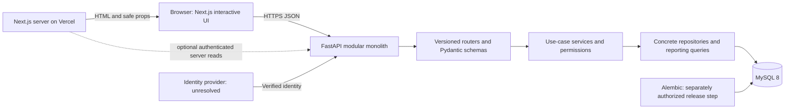

# CompanyOS system architecture

Status: Phase 0 specification for owner review, 2026-10-12. Documentation only. No implementation, database access, migration, installation, or deployment is authorized by this document.

## Authority and design boundaries

Read together with [requirements](requirements.md), [scope](mvp-scope.md), [stories](user-stories.md), [decisions](open-decisions.md), [ERDs](erd.md), [database design](database-design.md), and [migration plan](database-migration-plan.md). Exported schema facts are not live-state verification. USD for new approved salaries is confirmed; monthly is the agreed assumption. Precision/default changes and unrelated business policies remain provisional.

The current architecture brief specifies a modular monolith, REST `/api/v1`, FastAPI/Pydantic, SQLAlchemy 2.x/Alembic, MySQL 8, and Next.js App Router/TypeScript/Tailwind/shadcn/ui in one monorepo. Separate deployable frontend/backend does not mean microservices. No message broker, CQRS framework, generic repository hierarchy, event bus, background worker, or extra business table is needed.

## Components and trust boundaries

The browser and Next.js never connect to MySQL. Frontend access checks improve usability; FastAPI remains the authorization authority. Authentication transport/provider is unresolved; the first local slice uses a synthetic development identity as specified in [security-plan.md](security-plan.md).

## Proposed monorepo organization — paths only

| Location | Responsibility |
|---|---|
| apps/api/app/main.py | Application composition, middleware, router registration; no table creation |
| apps/api/app/core/ | Validated settings, principal/permission dependencies, safe errors/logging |
| apps/api/app/db/ | Engine, request-scoped session dependency, declarative metadata and four ORM mappings |
| apps/api/app/modules/employees/ | router.py, schemas.py, service.py, repository.py |
| apps/api/app/modules/departments/ | Same four concrete concerns |
| apps/api/app/modules/projects/ | Projects and assignment workflows, sharing one transaction when required |
| apps/api/app/modules/dashboard/ | Read-only aggregate schemas/service/repository/router |
| apps/api/app/system/ | Minimal liveness/readiness probes |
| apps/api/alembic/ | Reviewed revision history, created only in a later authorized phase |
| apps/api/tests/ | Contract, service, MySQL integration, security tests |
| apps/web/ | Next.js application; details in frontend architecture |
| docs/ and database/ | Specifications and immutable historical SQL evidence |

The repository now contains minimal apps/api and apps/web directories with credential-free environment templates only; the Python/TypeScript paths below remain planned, not implemented. Keep one concrete repository per feature where useful; do not add an interface plus implementation unless a real alternate implementation is needed. Cross-module services call shared operations explicitly; repositories do not call routers or start independent sessions.

## Request and persistence responsibilities

| Layer | Owns | Must not own |
|---|---|---|
| Router | HTTP parsing, authentication/role dependency, invoking service, selecting response schema | Business transaction logic or SQL |
| Pydantic schemas | Allowed fields, type/length/range validation, explicit role-specific output | Trust in raw ORM serialization or client-supplied permissions |
| Service | Business rules, transactional use case, projection policy, domain error mapping | Independent nested commits or provider SDK details |
| Repository | ORM statements, explicit locking, flush where necessary, aggregate queries | Commit, HTTP responses, session creation |
| DB dependency | One session per request, cleanup and rollback of unfinished work | Automatic success commit after response delivery |

Recommend synchronous SQLAlchemy sessions with synchronous DB-bound route execution initially; do not call blocking ORM work directly from async handlers. Driver/version choice is deferred to setup review. A session is not shared between requests or concurrent tasks. FastAPI dependencies support scoped cleanup; SQLAlchemy sessions require explicit lifecycle and transaction management. [FastAPI dependency lifecycle](https://fastapi.tiangolo.com/tutorial/dependencies/dependencies-with-yield/), [SQLAlchemy session guidance](https://docs.sqlalchemy.org/en/20/orm/session_basics.html)

Mutation service owns one transaction from business reads/locks through writes and output projection validation. Repository may flush to obtain IDs/detect constraints, but never commits. Build and validate the response DTO within that transaction; commit before returning success. On any validation/domain/integrity/commit failure, roll back and discard the response. The dependency closes the session and rolls back any leftover transaction; it never commits. Avoid autobegin ambiguity: identity verification must not issue business reads on this session before the service transaction starts. No streaming mutation response.

Read service owns a short read transaction where multiple statements must agree (page/count or dashboard totals); materialize permitted DTOs before session closure. No lazy loading during serialization. Read endpoints do not commit changes. Consistency across separate requests is not a snapshot guarantee.

Uniqueness/FKs are the final concurrency guard. Prechecks improve errors only. Map known constraint conflicts after rollback to safe 409 errors; do not expose SQL or record values. Proposed inactive-assignment prevention locks the employee row during both deactivation/status mutation and assignment creation. Use a consistent employee-before-project lock order where both are needed. Parent deletion is not offered. Preserve restrictive FKs, avoid ORM delete/delete-orphan cascades or automatic FK nulling; explicitly delete only the requested assignment pair. Deadlock/lock timeout rolls back the complete use case and returns retryable service failure; no blind mutation replay.

Prefer ORM/Core aggregate queries. A justified reporting query may use parameterized explicit SQL inside the dashboard repository, with a documented reason and integration tests. No interpolated sort names or user SQL. Counts must not multiply employees through assignment joins.

## Schema and money boundaries

Alembic is the only schema authority; no create_all or migration/stamp call at startup. Preserve company_db as training; companyos_dev is the owner-approved isolated development database target (creation requires separate execution approval), initialized later by reviewed migrations and synthetic fixtures. Test database isolation is likewise a proposal. Target salary Numeric(12,2) and hire-date-default removal require separate approval; the first read slice can use the baseline without promising target mutation behavior.

Decimal stays exact from input to storage; monetary JSON uses strings. USD/monthly response metadata is valid only in a new approved dataset with known semantics. Never connect the USD-labeled MVP to unverified training records. Budget currency for new approved MVP data is USD; legacy amounts must not be relabeled. No provenance/currency tables are added to work around this decision.

## Related specifications and gates

[API contract](api-contract.md) defines wire behavior; [security](security-plan.md) defines identity and field boundaries; [frontend](frontend-architecture.md) defines integration; [deployment](deployment-plan.md) defines environments; [first slice](first-vertical-slice.md) defines acceptance.

D21 is partially approved (development target only); remaining proposals are registered as D21–D23 in [open-decisions.md](open-decisions.md). Minimal repository structure is prepared under the owner's later setup instruction; application initialization, database provisioning, and implementation still await review. Provider choice, business-rule sign-off, target migrations, and public readiness remain separate gates.
