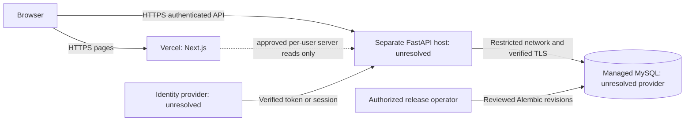

# CompanyOS environment and deployment plan

Status: Proposed specification, 2026-10-12. No infrastructure provisioned, credentials inspected, packages installed, database connected, migrations run, or deployment performed. Provider choices remain unresolved under D09/D17/D23.

## Environment topology

Frontend never has a DB credential. Keep API/DB geographically close where practical; choose region, cost, network connectivity, connection limits, backup retention, and recovery objectives with the owner. No provider is selected by this diagram. Vercel preview URLs do not automatically join the API origin allowlist and must not expose a development identity stub.

## Local environments — D21 partial approval

| Surface | Proposed address / database | Boundary |
|---|---|---|
| Next.js | http://localhost:3000 | Loopback only, synthetic data |
| FastAPI | http://localhost:8000 | API prefix /api/v1; loopback only |
| Browser API base URL | http://localhost:8000/api/v1 | Public config value, no secret |
| MySQL | localhost:3306 | Approved companyos_dev target; creation separately gated; never browser-connected |
| Integration tests | Proposed isolated companyos_test, pending approval | Explicit test guard; never training DB or ordinary dev DB |
| Existing company_db | Preserved training database | No app/test/migration target in this proposal |

Provisioning empty databases is a later authorized setup task; Alembic builds their table schema after provisioning. Fresh development schema comes from reviewed B0 and only approved deltas, not startup create_all or replay of legacy SQL. Use newly generated synthetic fixtures with documented USD/monthly salary semantics; no copy of company_db training rows. Test fixtures and cleanup are permitted only in the future designated disposable test database, never through a production endpoint.

## Proposed configuration contract — names only, no secret values

| Variable | Consumer / visibility | Local proposal | Production requirement |
|---|---|---|---|
| APP_ENV | Backend, server-only | local; test for tests | production/staging explicit; no default-to-local behavior |
| DATABASE_URL | Backend secret | Approved DSN targeting companyos_dev | Runtime least-privilege DSN to managed MySQL; encrypted transport configured |
| MIGRATION_DATABASE_URL | Authorized migration process secret only | Same approved database, separate privilege set | Not loaded into frontend or ordinary runtime; never automatic execution |
| TEST_DATABASE_URL | Test process secret only | companyos_test | Absent from production |
| EXPECTED_DATABASE_NAME | Backend/test server-only | companyos_dev or companyos_test | Explicit provisioned database name; mismatch fails readiness/startup validation |
| DB_TLS_CA_FILE | Backend filesystem/config reference | Optional for local loopback | Trusted CA/driver certificate verification; do not disable hostname verification |
| DB_POOL_SIZE / DB_MAX_OVERFLOW | Backend | Conservative values chosen at setup | Worker count × pool budget within managed DB limits |
| AUTH_MODE | Backend | development-stub explicitly | provider only; invalid/missing configuration fails closed |
| DEV_IDENTITY_ROLE | Backend dev/test only | Viewer; Administrator in controlled test runs | Forbidden in public config; never NEXT_PUBLIC |
| AUTH_ISSUER / AUTH_AUDIENCE | Backend auth configuration | Absent for stub | Values approved with actual provider |
| AUTH_JWKS_URL | Backend, if selected token format needs it | Absent | Trusted configured HTTPS endpoint, never arbitrary URL from token/header |
| CORS_ALLOWED_ORIGINS | Backend explicit list | http://localhost:3000 | Exact approved HTTPS frontend origins; not wildcard |
| SALARY_CURRENCY / SALARY_PERIOD | Backend config | USD / monthly for new synthetic dataset | USD / monthly for approved dataset only; not legacy conversion flags |
| DATASET_CONTEXT | Backend | synthetic-mvp | approved-mvp; reject training context for this salary-labeled API; not per-row provenance proof |
| BUDGET_CURRENCY | Backend configuration | USD for new synthetic MVP data | USD for approved MVP data, explicitly owner-confirmed; not a conversion or legacy provenance flag |
| API_BASE_URL | Next.js server-only | http://localhost:8000/api/v1 | Approved backend HTTPS URL; for future authenticated server calls |
| NEXT_PUBLIC_API_BASE_URL | Browser bundle | http://localhost:8000/api/v1 | Approved reachable HTTPS API base URL, no credentials; rebuild if baked configuration changes |
| Provider client/session variables | Selected auth adapter only | None | Names/scopes defined after provider/transport approval; client secret/session signing key server-only |
| LOG_LEVEL | Backend/frontend server | Development verbosity with redaction | Safe operational logging; no bodies or credentials |

These variables are a proposed setup contract. Credential-free templates now exist at [API .env.example](../apps/api/.env.example) and [web .env.example](../apps/web/.env.example); there are no configured .env files or running applications. Do not include DB passwords in documentation. No JWT signing secret is invented for a provider-backed system. Cross-origin cookie attributes and session secrets become required only if that transport is approved. CORS credential mode must match the selected transport.

## Release and security gates

Local S1–S7 may use stub identities and synthetic records but are not publicly deployable. S8 must verify real authentication and role enforcement before any public business endpoint or preview. S9 then verifies the full release with backups, monitoring, TLS, and agreed tests.

Future release sequence: approve settings/providers and data boundary; rehearse backup restoration and migration changes; run tests/builds/contracts; apply reviewed migrations in one controlled operator job; verify revision/readiness; deploy compatible API and frontend; verify both real roles and public health behavior; monitor safe errors. Do not grant Vercel build jobs automatic access to production migration credentials. No migration or table creation in application startup, scaling, or request handling.

Rollback application versions only while schema-compatible. Fractional salary writes can make numeric downgrade lossy; use [database-migration-plan.md](database-migration-plan.md) rather than automatic downgrade. A failed readiness check removes service from business traffic; liveness stays a separate process signal. Operational readiness probe must carry approved authentication or run through a protected operator path without weakening business authentication.

HTTPS covers browser/API/provider and verified MySQL TLS for managed connections. Restrict DB network access to authorized backend/migration paths, not the public internet or frontend. Configure trusted proxy headers/hosts explicitly. Backups, restore evidence, monitoring ownership, secret rotation, and abuse limits must be defined before public release. Exact provider-specific commands are intentionally absent.

## Approval checklist

D21 companyos_test approval, execution authorization and proposed port/guard details (companyos_dev target is already approved); D17 backend/database providers and region/budget; D09/D23 identity and transport; D18 response fields/budget visibility; enforcement of confirmed D20 no-import boundary (not an unresolved currency decision); D02 precision/D05 migration approvals. Database configuration and expected schema state are gates before S1 connectivity is actually executed. This document authorizes no such action.

## Template clarification after owner confirmation

The unchanged apps/api/.env.example comment predates the D21 confirmation and calls local/test targets proposals. The decision register now supersedes that comment for companyos_dev only. Blank DSNs still configure no connection; companyos_test and all provisioning remain gated. This documentation-only pass does not edit either environment template.
