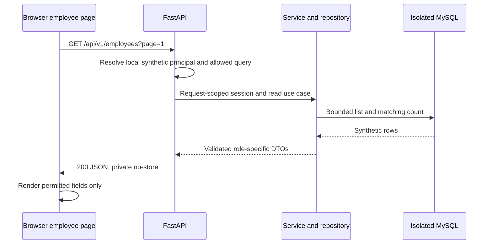

# CompanyOS first end-to-end vertical slice

Status: Proposed implementation outline for review, 2026-10-12. No code, setup, dependencies, database provisioning, SQL, migrations, or deployment performed.

## Objective and boundaries

Deliver local S1–S3: a Next.js employee listing backed by the real FastAPI GET API and isolated MySQL synthetic data, with Administrator/Viewer projections. Include liveness and authenticated readiness. No create/update/deactivate UI/API, department management, projects, dashboard, or real provider integration in this first slice. Those follow the approved vertical sequence later.

Sources: [architecture](architecture.md), [API contract](api-contract.md) endpoints 01–03, [security](security-plan.md), [frontend](frontend-architecture.md), [deployment](deployment-plan.md), and [baseline migration plan](database-migration-plan.md). Traceability: FR-E02/E06, US-E02/S01, NFR-01/02/03/06/07. US-S01 is only partially exercised with synthetic identities; real public identity remains incomplete.

## Approval prerequisites

- companyos_dev is the approved target, not an already-created database. Obtain separate creation/migration approval; companyos_test still needs target approval before any integration/destructive tests. company_db stays untouched.
- Review the baseline migration design and separately authorize future provisioning/migration/fixture actions. This outline itself gives no execution permission.
- Approve first-slice employee read allowlist/query contract (D09/D12/D18/D22). Recommend withholding Viewer hire_date as well as salary/email/budget under pending D18; approve this restrictive projection before employee contracts are implemented.
- T1 salary precision and T2 hire-date default changes are not prerequisites to a read-only first slice: it can run on reviewed B0 with explicitly chosen fixture dates and integer salaries. It must not claim target write behavior. Fixtures are new synthetic USD/monthly data, not imported training rows.
- Select concrete dependency versions/driver during setup review. Do not pick a production identity/hosting provider just to unblock local reads.

The first coding task is a smaller subset: [S1-01](phase-1-start.md), liveness only with no DB connection. Completion of that task does not claim completion of S1–S3.

## Future implementation order

1. Establish proposed apps/api and apps/web structure, validated settings, and repeatable test instructions. Keep current docs/database evidence intact.
2. Bootstrap FastAPI with /api/v1 routers, safe errors/request IDs, liveness, and a request-scoped DB dependency. No create_all or Alembic invocation at startup.
3. After separate authorization, provision isolated databases and apply the reviewed baseline through Alembic. Add synthetic fixtures only to those environments; enforce expected database-name/test guards.
4. Configure the local-only backend synthetic principal, default Viewer. Add permission checks and Pydantic Viewer/Administrator output models before list serialization.
5. Implement GET employees with bounded page/count queries, name search for Viewer, A-only name_email mode, status/department filters, stable sorts, nullable department/hire-date handling, and exact Decimal string output for A. Repository does not commit reads.
6. Implement readiness using bounded connectivity/schema-revision checks and no sensitive diagnostics. Readiness requires a principal; liveness is generic public status.
7. Implement /employees as a Server Component page/shell with a Client Component list connected to http://localhost:8000/api/v1. Use URL query state, typed API client, safe projection, cancellation, and loading/empty/error states. No static mock-only success criterion.
8. Verify with tests below; record results and limitations. Review before proceeding to employee mutations. Do not deploy this stub-authenticated slice publicly.

## Fixture specification — no fixture files generated

Use enough synthetic employee rows to cross a page boundary; repeated names; Active/Inactive/On Leave; assigned/unassigned departments; null/non-null hire dates; null/unique synthetic emails; integer exact salaries compatible with B0. Include an email-only search match whose name differs, and a zero-employee department. Use explicit dates/NULL handling in baseline fixtures so the old date default cannot fabricate a target behavior. No real addresses or copied training records.

## Acceptance evidence

| Check | Expected evidence |
|---|---|
| Real integration | Browser → FastAPI → isolated MySQL; changing an authorized disposable fixture changes the next response |
| Health | Liveness 200 without DB dependency; readiness 200 with valid principal/schema; DB unavailable/revision mismatch gives sanitized 503, missing auth gives 401 |
| Pagination | Correct totals/pages, bounded sizes, stable ID tie-breaker, empty/no-match/out-of-range pages handled |
| Search/filter | Viewer name search only; name_email and hire-date sort denied with 403; hidden email-only match does not affect Viewer rows/counts; status/department/unassigned work |
| Projection | No salary/email/hire_date/budget keys or values in Viewer API, HTML, Client props, logs, or nested department summaries; Administrator exact monetary strings |
| Query errors | Invalid page/status/sort/unknown query returns safe 422; no SQL interpolation or raw input leakage |
| Isolation | Test process refuses company_db and wrong database names; training SQL hashes/records not used or modified |
| Lifecycle | Session closes after success/failure; no global session, no commits on reads, no ORM access after closure |
| Identity | Both stub roles tested by trusted configuration/overrides; spoofed role headers ignored; public mode rejects stub configuration |
| Frontend | Controls call actual API; stale requests do not overwrite newer results; keyboard/mobile layouts; loading/error/empty distinct |
| Schema compatibility | Read slice passes on B0; no fractional writes, today-default claims, automatic schema mutation, or migration stamping |

Prefer MySQL 8 integration tests for database-specific behavior, not SQLite as sole evidence. Tests may use dependency overrides but must include actual HTTP/DB integration. Record test/build/type checks actually run later; this document claims no passing implementation tests.

## Exit and remaining gates

Local slice done means tests pass, API/UI integration is demonstrable, field projection is enforced, and security incompleteness is documented. Real provider/session integration, all remaining modules, reviewed target migrations, backups/production networking, and public verification are still outstanding. Owner review is required before the next phase; no public auth bypass is acceptable.
